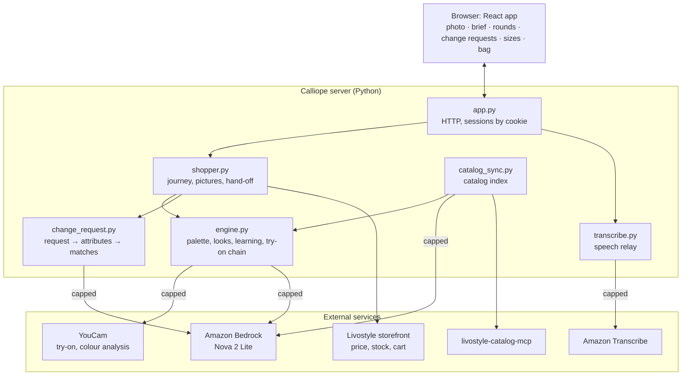
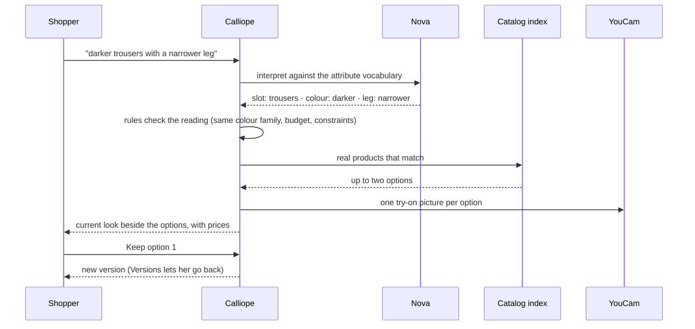

# Calliope

She has an anniversary dinner on Saturday, about $200 to spend, and she won't wear heels. She adds a full-length photo
and says exactly that. Calliope reads her colouring from the photo, picks a palette, and shows two complete outfits
on her: top, trousers, flat shoes and a necklace, each a real Livostyle product in stock in the colour pictured. She
keeps one, then compares it against a challenger shaped by what she just chose. She says what she liked about the
winner ("the colours"), picks a final look, and then asks: "darker trousers with a narrower leg." Calliope shows her
current outfit next to up to two real alternatives, each with its own try-on picture and price. Darker stays in the
same colour family unless she names a new colour. She keeps one, chooses sizes, and taps the bag button. One item's
price has gone up at Livostyle since she started, so before the cart opens Calliope shows the old and new price and the
new subtotal, and waits for her OK.

Calliope is a styling assistant on top of the Livostyle catalog. The shopper brings a photo and a brief, typed or
spoken. Calliope does the rest: colour analysis, try-on pictures of complete outfits, two comparison rounds that learn
from each choice, change requests in plain words, and a hand-off to the Livostyle cart with the exact variants. Looks
are either separates (top, trousers, shoes, necklace) or a dress with shoes and a necklace. A shopper can also add a
top they already own, and Calliope builds the outfit around it. A finished look can be shared as a read-only link.

## How it works



Every edge marked *capped* is a paid call, checked against its spending cap before it is made.

**Catalog.** `catalog_sync.py` lists the whole Livostyle catalog through its MCP server, joins it with the open
dataset, classifies each top, dress, trouser, shoe and necklace (colour, neckline, sleeves, rise, leg, length,
silhouette) and activates a new index only when it passes validation. Classification from product data and pixels is
free; Nova is called only for new or changed products, under a per-build cap. A snapshot of the index ships in
`data/catalog.json`, so the first start is instant. Freshness is checked when the server starts and when a session
starts, and an overdue index keeps serving while a new one builds in the background.

**Photo and palette.** The photo is checked (format, size, light, portrait framing). Nova finds the face and checks
the eyes; OpenCV refines the face box; YouCam reads the colouring, and `seasons.py` turns it into a suggested palette
and an alternative.

**Looks and learning.** `engine.py` assembles complete outfits from the index within the budget, the occasion's dress
level and the shopper's constraints (no heels, dress or separates). Each round's choice is compared with the look it
beat, and the differences (colour, shape, feel) become signals that rank the challenger and the final proposal. The
shopper's stated reasons confirm or override them.

**Try-on pictures.** Each look is pictured as a chain of YouCam steps on the shopper's photo: top or dress, then
trousers, shoes and necklace, with a tuck edit when the top is meant to be worn tucked in. Each step is keyed by its
inputs, so a repeated or partly changed look reuses the steps that didn't change and pays only for the new ones.

**Change requests.** The model proposes; code decides:



If no product matches, Calliope says so and offers a labelled alternative, such as a different colour. A request that
could mean cut or size ("tighter") gets a clarifying question. Product ids the model suggests are used only if they are
in the index.

**Hand-off.** At the bag, Calliope reads the live variant, stock and price for each piece in the chosen size and the
pictured colour. If anything differs from what was shown, it lists the changes and the new merchandise subtotal and
opens the cart only after the shopper accepts that exact quote (or, over budget, changes a piece or raises the budget
explicitly). A top the shopper owns stays out of the cart.

**Voice.** The browser streams 16 kHz audio to the server, which relays it to Amazon Transcribe. The words fill the
text box as she speaks and wait there until she taps Go.

## Run locally

### Prerequisites

- macOS or Linux.
- Python 3.9 or newer (verified on 3.9.6).
- Node.js 20.19+ or 22.12+, with npm (verified on Node 25.2.1, npm 11.6.2). Node runs the catalog MCP server, the
  frontend build and the browser tests.
- Port `8765` free (change it with `PORT`).
- A **YouCam API key** from the YouCam developer console (<https://yce.makeupar.com>), with units available.
- An **AWS profile** in `~/.aws` (default name `calliope`; set `AWS_PROFILE` to use your own) in `us-east-1`, allowed:
  - `bedrock:InvokeModel` on the Nova 2 Lite inference profile `us.amazon.nova-2-lite-v1:0`, with model access enabled;
  - `transcribe:StartStreamTranscriptionWebSocket`, for voice input (optional; typing always works).
- A full-length photo you have permission to use: head to shoes, even light, head level, no necklace or sunglasses.

### Install

```bash
git clone https://github.com/markbrazinski/calliope.git
cd calliope
python3 -m venv .venv
.venv/bin/pip install -r requirements.txt
npm ci
npx playwright install chromium               # browser tests only
```

Check the install. The local checks use a scripted MCP and a test provider, so they need no credentials and make no
paid calls:

```bash
npm run check
```

They take about a minute and end with:

```text
tuck checks ok
sellable checks ok
wish checks ok
transcribe self-check ok
```

### Configure

```bash
cp .env.example .env
```

Fill in `.env` (it is git-ignored). AWS keys are read from the profile, never from `.env`.

| Setting | What for | Example |
|---|---|---|
| `YOUCAM_API_KEY` | Try-on pictures and colour analysis | your key |
| `AWS_PROFILE`, `AWS_REGION` | Nova and Transcribe | `calliope`, `us-east-1` |
| `CALLIOPE_LIVE_UNITS` | YouCam units this server may spend | `80` |
| `CALLIOPE_NOVA_USD` | Nova spending cap for this server, in USD | `0.05` |
| `CALLIOPE_TRANSCRIBE_USD` | Transcribe spending cap in USD; leave unset to turn voice input off | `0.25` |
| `CALLIOPE_CATALOG_REFRESH_DAYS` | Days before the catalog index is refreshed | `7` |
| `CALLIOPE_CATALOG_NOVA_USD` | Most one catalog build may spend on Nova classification | `0.05` |

Each cap is a hard stop, checked before every paid call.

**What it costs.** One unit is about $0.055.

| Action | YouCam | Nova | Transcribe |
|---|---|---|---|
| Colour reading | 20 units | | |
| One outfit picture | up to 7 units | | |
| One change request (up to two options pictured) | 6–10 units | | |
| A full journey with one change request | 55–65 units (about $3–3.60) | about $0.003 | |
| Speaking a brief or request | | | $0.024 per minute |
| A catalog refresh (new or changed products only) | | at most `CALLIOPE_CATALOG_NOVA_USD` | |

Pictures already made for the same inputs are reused and cost nothing.

### Start

```bash
npm start
```

This builds the frontend and starts the server:

```text
✓ built in 224ms
Catalog: ready, built 2026-10-13T13:21:23+00:00 (16.6 days old, refreshing in the background)  ·  Installed the shipped catalog snapshot
Calliope on http://127.0.0.1:8765/  ·  live providers
```

The first start installs the shipped catalog snapshot. If it is older than `CALLIOPE_CATALOG_REFRESH_DAYS`, a refresh
from the MCP runs in the background (a few seconds to list the catalog, then classification) while the snapshot
keeps serving.

### Health check

```bash
curl -s http://127.0.0.1:8765/api/status
```

```text
{"available": true, "mode": "live", "message": null, "action": null,
 "speech": {"available": true, ...},
 "catalog": {"ready": true, "state": "ready", "builtAt": "2026-10-13T13:21:23+00:00", ...}}
```

If a setting is missing, `available` is `false` and `action` names it; the page shows the same message and starts
nothing. Catalog commands:

| Command | What it does |
|---|---|
| `.venv/bin/python app.py --catalog-status` | Active index, its age, next refresh, last build |
| `.venv/bin/python catalog_sync.py plan` | Dry run: what a refresh would fetch and classify, and the estimated cost |
| `npm run catalog` | Refresh now (also `POST /api/catalog/refresh`) |

### Try it

Open <http://127.0.0.1:8765/>. `?new=1` starts a new session.

1. Add your full-length photo. Optionally, tap **+ Add clothes to pair** and add a photo of a top you own.
2. Type the brief, for example "Anniversary dinner, about $200, no heels", and tap **Go**. Or tap **Speak**, say it,
   and tap again to stop; the words wait in the box until you tap Go.
3. Check the chips Calliope read from the brief, then tap **Open fitting room** and pick a palette.
4. Round 1: keep one look. Round 2: keep it again or take the challenger.
5. Say what to carry forward (colours, shape, overall feel), then pick a final outfit.
6. Ask for a change: "darker trousers", "a v-neck top", "a longer dress", "darker trousers in black", or "darker and
   tighter trousers" (Calliope asks whether you mean the cut or the size). Keep one option, or go back with Versions.
7. Choose sizes. **Share** makes a read-only link. The bag button opens the Livostyle cart with the exact variants.

### Voice on a phone (optional)

Browsers allow the microphone only on secure pages. `http://localhost` works on the computer; a phone needs HTTPS.

```bash
brew install mkcert && mkcert -install
mkcert 192.168.1.50                           # your LAN address: ipconfig getifaddr en0
CALLIOPE_HOST=0.0.0.0 CALLIOPE_TLS_CERT=./192.168.1.50.pem CALLIOPE_TLS_KEY=./192.168.1.50-key.pem npm start
```

Trust the mkcert root on the phone. On iPhone, AirDrop `$(mkcert -CAROOT)/rootCA.pem`, install the profile, then
enable it under Settings › General › About › Certificate Trust Settings. On Android, use Settings › Security › Install
a certificate. Then open `https://192.168.1.50:8765/` on the same Wi-Fi. Set `CALLIOPE_BASIC_AUTH=user:password` when
the server is reachable beyond your computer.

### Verification

| Command | Covers | Result |
|---|---|---|
| `npm run check` | Server self-check, catalog setup and refresh, learning, choice effect, change requests, colour intent, price reconciliation, image caches, tuck, sellability, open-ended wishes, speech framing | 11 groups ok, about 70 s |
| `node tests/verify-prices-ui.mjs` | The price-change sheet in the browser | 7 passed, about 12 s |
| `node tests/verify-live.mjs` | Full journeys in a desktop and a phone browser, unavailable providers, the necklace check, reads the live Livostyle storefront at the bag | 116 passed, about 7 min |
| `CALLIOPE_NLU=nova .venv/bin/python tests/check_revisions.py` | Change requests through live Nova | about $0.01 |
| `node tests/live-run.mjs <base> <run.json> <out>` | A full live journey against a running server, with your photo | YouCam units |

The local checks and both browser tests use a scripted MCP and a test provider that returns labelled stand-in
pictures, so they are repeatable and free. Each browser test starts its own servers on temporary state.
`tests/verify-speech.mjs` drives real microphone audio through the page against a local Transcribe stand-in
(`tests/fake_transcribe.py`); its arguments are in the file header.

### Troubleshooting

- **`UNAVAILABLE: YOUCAM_API_KEY is not set; …`** at startup, or "Calliope isn't available right now" on the page:
  fill in the settings it names in `.env` and restart.
- **`AWS profile for Nova: ProfileNotFound`** or **`no AWS credentials for Nova`**: create the profile in `~/.aws`, or
  set `AWS_PROFILE` to one you have.
- **Voice input isn't available**: set `CALLIOPE_TRANSCRIBE_USD`. On a phone, use HTTPS (above).
- **A photo is refused**: the message names the check (too dark, too small, not a portrait, face too small or turned,
  eyes covered). Use a well-lit, head-to-shoes photo.
- **The catalog refresh failed**: the previous index keeps serving and the page shows **Try again**. Run
  `.venv/bin/python catalog_sync.py plan` to see the error.
- **`Note: the frontend isn't built`**: start with `npm start`, or run `npm run build`.
- **Port in use**: `PORT=8766 npm start`.

### Shutdown

Press Ctrl-C. Sessions, pictures, spend ledgers and the active catalog index live under `state/` (git-ignored) and
survive a restart. Delete `state/app/` to clear sessions; session content expires after 7 days and share links after
14.

## Technologies and dependencies

- **Python 3.9+**, standard-library HTTP server. Pillow `11.3.0` (photo checks and conversion), opencv-python-headless
  `4.14.0.94` (face box refinement), boto3 `1.42.97` (Bedrock and Transcribe signing).
- **Amazon Bedrock, Nova 2 Lite** (`us.amazon.nova-2-lite-v1:0`): face box, eye check, reading an owned top, change
  request interpretation, catalog classification of new products.
- **Amazon Transcribe** streaming over WebSocket, signed with SigV4 on the server.
- **YouCam APIs**: AI clothes virtual try-on and colour analysis.
- **livostyle-catalog-mcp** `0.1.0` over stdio, and the Livostyle Women's Fashion Catalog open dataset (MIT).
- **React** `18.3.1` built with **Vite** `8.3.4`.
- **Playwright** `1.63.0` for browser tests.

Licences for bundled fonts, vendored code and catalog data are in [`THIRD_PARTY_NOTICES.md`](THIRD_PARTY_NOTICES.md)
and [`licenses/`](licenses/).

## Repository structure

```text
app.py                  HTTP server, configuration, routes (/api/*), HTTPS option
shopper.py              sessions, journey, pictures, change requests, sizes, hand-off, shares
engine.py               colour analysis, look selection, learning from rounds, try-on chain
change_request.py       change-request interpretation (Nova reading checked by rules)
attributes.py           attribute vocabulary and matching (attributes.json)
catalog_sync.py         catalog index from the Livostyle MCP: listing, join, change detection, classification, activation
transcribe.py           Amazon Transcribe streaming and its spend meter
seasons.py, palette.py  palettes (palettes.json)
nova_common.py          Bedrock Converse client with a spend cap
provider_stub.py        the test provider behind CALLIOPE_PROVIDER=stub, used by the automated tests
data/                   shipped catalog snapshot and classification cache, occasions, constraints, tuck rule
frontend/               React app, built into frontend/dist
tests/                  checks and browser tests
tools/                  catalog maintenance (index build history, classification seeding)
scripts/preview.sh      HTTPS tunnel for previewing on another device
licenses/               third-party licences
```

## License

Apache-2.0. See [`LICENSE`](LICENSE).

## Scope

- **The model proposes; code decides.** Nova reads photos and requests into a fixed attribute vocabulary. Rules check
  the reading, and only products in the catalog index can be offered.
- **Spending is capped before it happens.** YouCam units, Nova and Transcribe each have a cap, checked before every paid
  call. When a setting or cap is missing, the app names it and starts nothing.
- **Every piece is buyable as pictured.** Looks use in-stock variants in the pictured colour, and the hand-off rechecks
  variant, stock and price live before the cart opens.
- **Prices are confirmed before checkout.** Any change from the price shown needs the shopper's OK on that exact quote.
  Tax and shipping are set at Livostyle checkout.
- **Your clothes stay yours.** A top the shopper adds is styled with and pictured, and stays out of the cart.
- **One session per browser.** A browser owns its session through an HttpOnly cookie; shares are read-only snapshots
  that expire after 14 days.
- **Women's styling on the Livostyle catalog.** Separates or a dress, with shoes and a necklace, for one shopper at a
  time.
